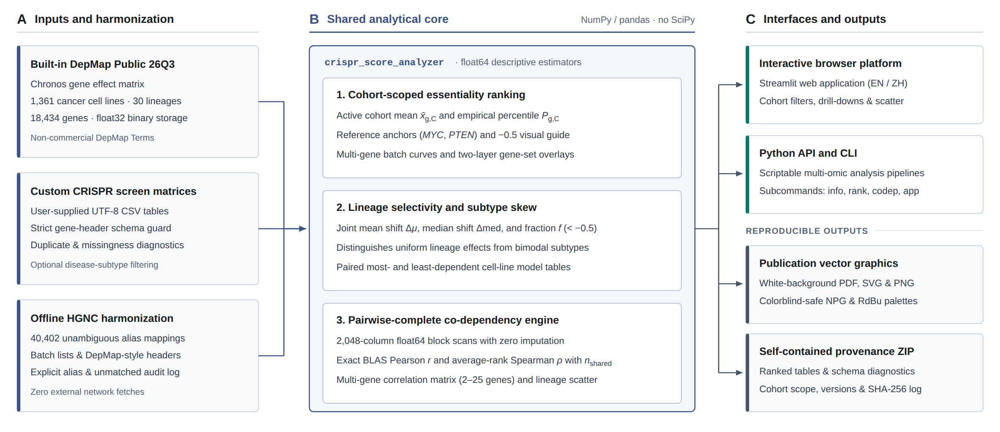
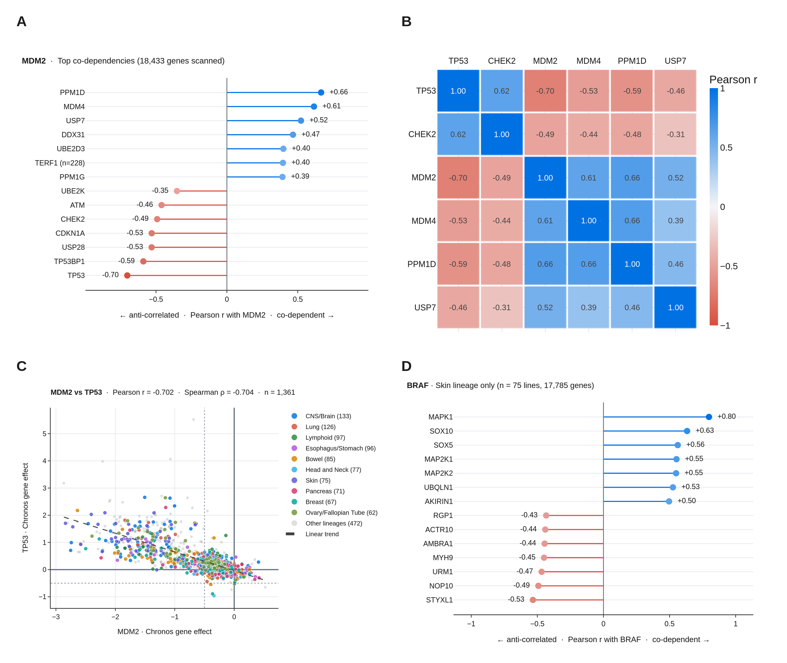

# CRISPR Score Analyzer: cohort-scoped essentiality and co-dependency analysis of DepMap CRISPR-Cas9 screens

**Changhao Kan¹,\***

¹ Institute of Molecular Physiology, Shenzhen Bay Laboratory, Shenzhen, China  
\* Correspondence: `kanchanghao@szbl.ac.cn`  
ORCID: [0009-0000-4014-5923](https://orcid.org/0009-0000-4014-5923)

---

## Abstract

Genome-scale CRISPR-Cas9 loss-of-function screens in the Cancer Dependency Map, or DepMap, provide a standard reference for prioritizing cancer vulnerabilities and mapping functional gene relationships. Beyond single-gene portal queries, however, exploratory analyses routinely confront three methodological problems: pan-cancer averages dilute lineage- and subtype-restricted dependencies, multi-library integration produces uneven gene coverage across cell lines, and pan-cancer co-essentiality profiles conflate pathway co-functionality with baseline differences between tumor lineages. Here we present CRISPR Score Analyzer, an open-source Python package, command-line interface, and browser platform built on a single analytical core over DepMap Public 26Q3 Chronos scores spanning 1,361 cancer cell lines, 30 Oncotree lineages, and 18,434 genes, alongside validated custom screen matrices. The analytical engine provides cohort-scoped essentiality ranking, joint mean and median lineage-selectivity decomposition, exact pairwise-complete `float64` Pearson and average-rank Spearman genome-wide scans in 2,048-column blocks without SciPy, offline HGNC symbol harmonization across 40,402 alias mappings, vector graphics export, and provenance archiving. Auditing DepMap Public 26Q3 shows that 1,352 genes, or 7.33% of the matrix, lack full cell-line coverage with `n_valid` falling as low as 218, motivating explicit pairwise overlap reporting alongside every correlation. Chunked kernels agree with direct reference calculations to machine precision, within 7.77 × 10⁻¹⁶ for Pearson *r* and 5.55 × 10⁻¹⁷ for Spearman *ρ*, and complete a pan-cancer Pearson scan in 0.74 s or a single-lineage Skin scan in 0.10 s. Across ten canonical cancer gene pairs, cohort scoping separates pan-lineage epistatic axes such as *MDM2*–*TP53* from context-restricted modules whose pan-cancer rank correlations collapse toward zero, including *BRAF*–*MAP2K1* and *ESR1*–*GATA3*. Source code is available under the MIT license at https://github.com/ChanghaoKan/crispr-score-analyzer with a hosted application at https://crispr-score-analyzer-szbl-denglab.streamlit.app/.

**Keywords:** DepMap; CRISPR-Cas9 screen; Chronos gene effect; gene essentiality; co-dependency; functional genomics

---

## 1. Introduction

Pooled genome-scale CRISPR-Cas9 loss-of-function screens across human cancer cell lines provide a primary experimental reference for identifying lineage-specific vulnerabilities and mapping functional gene relationships (Meyers *et al.*, 2017; Pacini *et al.*, 2021). Within the Cancer Dependency Map, or DepMap (Tsherniak *et al.*, 2017), copy-number- and growth-kinetics-corrected Chronos gene effect scores (Dempster *et al.*, 2021) allow candidate genes nominated by transcriptomics, proteomics, or focused genetic screens to be evaluated rapidly against pan-cancer essentiality distributions.

Moving beyond single-gene portal lookups, however, exposes three recurring analytical limitations. First, pan-cancer averages frequently obscure lineage- and subtype-restricted dependencies: an oncogene or lineage transcription factor strongly essential in one tumor type can appear near-neutral across more than a thousand models, while intra-lineage heterogeneity can separate lineage means from medians. Second, integrating screens conducted with different sgRNA libraries introduces uneven gene coverage across cell-line subsets (Pacini *et al.*, 2021), so genome-wide correlation rankings computed without tracking pairwise sample overlap can place sparsely profiled genes alongside full-cohort associations. Third, pan-cancer co-essentiality profiles conflate direct pathway co-functionality with baseline mean differences between tumor lineages. Covariance-whitening and dimensionality-reduction approaches address correlated sample structure when building whole-genome co-essentiality networks (Boyle *et al.*, 2018; Wainberg *et al.*, 2021; Gheorghe & Hart, 2022), yet rely on offline matrix transformations rather than direct inspection within a user-defined lineage or disease subset. Existing web resources such as the DepMap Portal (https://depmap.org/portal/) and shinyDepMap (Shimada *et al.*, 2021) serve single-gene queries and global overviews well, whereas multi-gene batch positioning, single-lineage co-dependency scanning, paired cell-line selection, and reproducible scripted execution remain fragmented across separate interfaces and custom scripts.

Here we describe CRISPR Score Analyzer, an open-source Python library (`crispr_score_analyzer`), command-line interface (`crispr-score-analyzer`), and interactive browser platform built on a shared analytical core over DepMap Public 26Q3 Chronos scores and validated custom matrices. Rather than introducing a latent-factor normalization model, the software provides transparent, cohort-scoped descriptive estimators: exact pairwise-complete Pearson and Spearman scanning without imputation, joint mean and median lineage-selectivity summaries linked directly to individual cell-line identities, offline HGNC symbol harmonization, and self-contained provenance archives. Using DepMap Public 26Q3, we audit gene-coverage missingness, verify numerical accuracy and runtime scaling of the chunked correlation kernels, and benchmark pan-cancer against cohort-scoped co-dependency across ten canonical cancer gene pairs spanning pan-lineage epistatic axes, lineage-restricted signaling cascades, and subtype-dependent transcriptional modules.

---

## 2. Results

### 2.1 Architecture and analytical scope of CRISPR Score Analyzer

CRISPR Score Analyzer separates analytical computation from user-interface presentation through a modular, Streamlit-free Python library (`crispr_score_analyzer`; archived at release `v1.2.0`, Kan, 2026) that drives both a scriptable CLI and a bilingual browser application (**Figure 1**). All cohort-scoped essentiality rankings, lineage-selectivity decompositions, and pairwise-complete co-dependency scans run in `float64` precision on top of NumPy and pandas without requiring SciPy. Offline HGNC alias resolution harmonizes batch gene queries across 40,402 unambiguous symbol mappings, while plotting and export routines produce white-background vector graphics and self-contained provenance archives. Relative to existing interactive DepMap portals, the platform unifies multi-gene cohort positioning, single-step lineage-scoped co-dependency scanning, joint mean–median skew diagnostics, custom screen ingestion, and scripted Python execution on identical estimators (**Table 1**).

**Figure 1. Software architecture and analytical workflow of CRISPR Score Analyzer.** **A.** Data ingestion and offline nomenclature layer supporting the bundled DepMap Public 26Q3 Chronos matrix, validated user-supplied UTF-8 CSV screens, and 40,402 unambiguous HGNC alias mappings. **B.** Shared `crispr_score_analyzer` Python analytical core executing `float64` cohort-scoped essentiality ranking, joint mean and median lineage-selectivity decomposition, and 2,048-column pairwise-complete Pearson and Spearman co-dependency scans without SciPy. **C.** Dual execution interfaces—a bilingual Streamlit browser platform and a scriptable Python API and CLI—producing white-background vector figures and self-contained SHA-256 provenance archives.

**Table 1. Comparison of analytical and reproducibility capabilities across CRISPR Score Analyzer and existing DepMap interfaces, verified November 2026.**

| Analytical capability | DepMap Portal (26Q3) | shinyDepMap (eLife 2021) | CRISPR Score Analyzer (`v1.2.0` / `preprint-v6`) |
|---|---|---|---|
| Multi-gene panel placement on cohort curve | Single-gene default | Efficacy vs. selectivity scatter | Batch ranking and two-layer gene-set annotation |
| Cohort-scoped genome-wide co-dependency scan | Pan-cancer default; multi-step subsetting | Pan-cancer connectivity clusters | Single-step scoped scan with exact pairwise Pearson *r* and Spearman *ρ* |
| Pairwise multi-gene matrix and lineage scatter | Multi-panel explorer | Cluster network view | 2–25 gene heatmap linked to lineage-colored scatter |
| Lineage selectivity and intra-lineage skew | Per-gene lineage and subtype plots | Not provided | Joint $\Delta\mu$, $\Delta\mathrm{med}$, and fraction $< -0.5$ lollipop and heatmap |
| Sensitive and resistant cell-line selection | Table filtering on gene page | Top sensitive lines | Paired most- and least-dependent tables with `ModelID` export |
| Custom matrix ingestion and schema audit | Single-feature vector | Not supported | Full UTF-8 CSV matrix with schema guard and diagnostics |
| Offline batch HGNC harmonization | Online single-gene search | Not provided | 40,402 unambiguous offline mappings for batch and single queries |
| Scriptable Python API, CLI, and provenance | Web portal and bulk downloads | R Shiny web app only | Installable Python library, CLI, vector export, and SHA-256 archive |

### 2.2 Coverage heterogeneity, numerical fidelity, and runtime scaling in DepMap Public 26Q3

Auditing the DepMap Public 26Q3 Chronos matrix across 1,361 cancer cell lines and 18,434 genes reveals substantial gene-level missingness arising from multi-library integration. Pan-cancer gene means span −5.250 to +0.398, with 1,712 genes falling below −0.5. Although 17,082 genes, or 92.67%, are profiled across all 1,361 cell lines, 1,352 genes, or 7.33%, have incomplete coverage ranging down to `n_valid` = 218. Within this incomplete subset, 648 genes are assayed in fewer than 1,000 cell lines and 519 in fewer than 500. In genome-wide correlation scans over such heterogeneous matrices, failing to preserve exact pairwise overlap or omitting `n_shared` from ranked outputs risks conflating sparse sub-cohort associations with full-panel correlations.

We verified numerical equivalence of the chunked `float64` correlation engine against direct reference evaluations using `pandas.Series.corr` for Pearson *r* and pairwise midrank `numpy.corrcoef` for Spearman *ρ* across top, bottom, and partially observed partners of *MDM2*—193 genes for Pearson and 100 for Spearman. Maximum absolute deviations were 7.77 × 10⁻¹⁶ for Pearson *r* and 5.55 × 10⁻¹⁷ for Spearman *ρ*, confirming machine-precision agreement across both complete and incomplete gene columns. On a 2-vCPU Linux environment, median wall-clock runtimes across three replicates were 1.01 s to load the binary matrix and 0.41 s to rank all 18,434 genes. A genome-wide pan-cancer scan across all 1,361 models and 18,433 partner genes finished in 0.74 s for Pearson *r* and 6.19 s for Spearman *ρ*. Restricting the cohort to a single lineage, Skin (*n* = 75), reduced scan runtimes to 0.10 s for Pearson and 0.44 s for Spearman, enabling interactive exploration across both metrics.

### 2.3 Lineage-selectivity decomposition resolves subtype-driven skew

Positioning a five-gene benchmark panel—*KRAS*, *SOX10*, *BRAF*, *ESR1*, and *TP53*—on the pan-cancer Chronos ranking curve illustrates how global averages compress context-restricted vulnerabilities (**Figure 2A**). Relative to reference anchors *MYC* at mean −1.971 (rank 187, 1.01%) and *PTEN* at mean +0.377 (rank 18,428, 99.97%), *KRAS* falls below the −0.5 visual reference across all lineages at mean −0.729 (rank 1,263, 6.85%), whereas *TP53* sits at the positive extreme at mean +0.381 (rank 18,430, 99.98%), reflecting positive growth-rate effects upon tumor-suppressor knockout in *TP53*-wild-type lines (Dempster *et al.*, 2021). By contrast, two canonical lineage-dependent targets appear modest or near-neutral in pan-cancer averages: *SOX10* averages −0.347 (rank 2,225, 12.07%) and *ESR1* averages −0.065 (rank 7,347, 39.86%). Two-layer gene-set annotation similarly positions mitotic kinases *PLK1* at mean −2.691 (rank 38, 0.21%) and *AURKA* at mean −1.236 (rank 626, 3.40%) against seven cell-cycle CDK and cyclin genes ranging from *CDK1* at −2.588 to *CCNE1* at −0.194 (**Figure 2B**).

**Figure 2. Multi-gene essentiality positioning and lineage-selectivity decomposition in DepMap Public 26Q3.** **A.** Pan-cancer mean Chronos gene effect curve across 1,361 cell lines and 18,434 genes positioning five benchmark genes (*KRAS*, *SOX10*, *BRAF*, *ESR1*, *TP53*) relative to *MYC* and *PTEN* anchors and the −0.5 reference guide. **B.** Two-layer gene-set annotation overlaying *PLK1* and *AURKA* onto seven cell-cycle CDK and cyclin genes (*CDK1*, *CDK2*, *CDK4*, *CDK6*, *CCNB1*, *CCND1*, *CCNE1*). **C, D.** Lineage-preference lollipop plots showing top and bottom four lineages with *n* ≥ 5 on gene-specific scales, displaying mean Chronos shifts $\Delta\mu$ relative to each gene's all-lineage mean for *SOX10* (**C**) and *ESR1* (**D**).

Evaluating mean shift $\Delta\mu$ jointly with median shift $\Delta\mathrm{med}$ and sensitive fraction $f_{g,\ell}$ separates uniform lineage essentiality from subtype-restricted bimodality (**Figure 2C, D**). For *SOX10*, Skin (*n* = 75) shows concordant mean and median shifts—mean −1.487, $\Delta\mu = -1.140$, $\Delta\mathrm{med} = -1.368$, and 78.7% of lines below −0.5—consistent with broad neural-crest dependency in cutaneous melanoma. In Eye (*n* = 15), however, the mean shift of $\Delta\mu = -0.535$ (mean −0.882, 46.7% below −0.5) is more than threefold stronger than the median shift of $\Delta\mathrm{med} = -0.174$. This divergence flags a bimodal distribution driven by strongly dependent uveal melanoma models such as `Omm2.5` at −2.752, `UPMM3` at −2.113, and `WM3772F` at −1.678 mixed with near-neutral retinoblastoma lines. A comparable subtype-masking effect arises for *ESR1* in Breast (*n* = 67), where Oncotree lineage grouping pools ER-positive luminal models with ER-negative subtypes. The resulting Breast shift—mean −0.285, $\Delta\mu = -0.220$, $\Delta\mathrm{med} = -0.061$, and 17.9% of lines below −0.5—is only slightly larger than a nine-line Ampulla of Vater group ($\Delta\mu = -0.174$, $\Delta\mathrm{med} = -0.059$). Inspecting the ranked cell-line table resolves this aggregation immediately by surfacing strongly dependent ER-positive luminal models led by `HCC1428` at −1.912, `T-47D` at −1.845, and `MDA-MB-415` at −1.636 alongside resistant controls.

### 2.4 Cohort scope reshapes co-dependency inference across canonical cancer axes

To quantify how cohort scope alters co-dependency inference, we benchmarked ten established cancer gene pairs across three estimation regimes in DepMap Public 26Q3: pan-cancer Pearson *r* and Spearman *ρ* across all 1,361 models, pooled within-lineage Pearson correlation $r_{\mathrm{within}}$ after subtracting lineage means across all 30 lineages, and single-lineage Pearson *r* and Spearman *ρ* within each pair's primary biological context (**Table 2**).

**Table 2. Pan-cancer, lineage-demeaned, and target-lineage co-dependency across ten canonical cancer gene pairs in DepMap Public 26Q3 (all pan-cancer pairs *n* = 1,361).**

| Gene pair | Target lineage (*n*) | Pan *r* | Pan *ρ* | $r_{\mathrm{within}}$ | Lineage *r* | Lineage *ρ* | Empirical regime |
|---|---:|---:|---:|---:|---:|---:|---|
| *MDM2*–*TP53* | Lung (126) | −0.702 | −0.704 | −0.648 | −0.802 | −0.500 | Pan-lineage epistatic |
| *MDM2*–*PPM1D* | Lung (126) | +0.664 | +0.658 | +0.635 | +0.642 | +0.584 | Pan-lineage epistatic |
| *BRAF*–*MAPK1* | Skin (75) | +0.644 | +0.451 | +0.538 | +0.798 | +0.787 | Lineage-enriched pathway |
| *BRAF*–*MAP2K1* | Skin (75) | +0.391 | +0.097 | +0.303 | +0.552 | +0.605 | Lineage-enriched pathway |
| *BRAF*–*SOX10* | Skin (75) | +0.544 | +0.196 | +0.294 | +0.633 | +0.643 | Lineage co-enrichment / subtype |
| *SOX10*–*MITF* | Skin (75) | +0.492 | +0.153 | +0.286 | +0.418 | +0.384 | Lineage-restricted TF axis |
| *ESR1*–*FOXA1* | Breast (67) | +0.324 | +0.111 | +0.259 | +0.503 | +0.346 | Subtype-restricted TF axis |
| *ESR1*–*GATA3* | Breast (67) | +0.253 | +0.095 | +0.228 | +0.596 | +0.372 | Subtype-restricted TF axis |
| *CDK4*–*CCND1* | Breast (67) | +0.416 | +0.380 | +0.425 | +0.704 | +0.635 | Context-amplified cell cycle |
| *KRAS*–*RAF1* | Bowel (85) | +0.338 | +0.255 | +0.319 | +0.530 | +0.461 | Lineage-amplified effector |

The benchmark separates three distinct statistical regimes. First, pan-lineage epistatic pairs such as *MDM2*–*TP53* and *MDM2*–*PPM1D* show close agreement across pan-cancer *r*, pan-cancer *ρ*, and lineage-demeaned $r_{\mathrm{within}}$: for *MDM2*–*TP53*, the three estimators yield −0.702, −0.704, and −0.648. In a genome-wide pan-cancer scan of *MDM2* across 18,433 genes (**Figure 3A**), top positive partners include *PPM1D* (+0.664), *MDM4* (+0.614), *USP7* (+0.522), *DDX31* (+0.466), and *UBE2D3* (+0.398), whereas top anti-correlated partners recover the p53 tumor-suppressor axis—*TP53* (−0.702), *TP53BP1* (−0.589), *USP28* (−0.531), *CDKN1A* (−0.530), *CHEK2* (−0.491), and *ATM* (−0.461)—all profiled across all 1,361 cell lines. Annotating `n_shared` directly on the figure flags rank-6 positive hit *TERF1* (+0.395) as partially covered across only 228 shared lines, immediately separating it from full-cohort associations. Multi-gene matrix inspection of the six-gene regulatory axis resolves its two-block inverse structure (**Figure 3B**). Across all 23 lineages containing at least 15 models, *MDM2* and *TP53* remained negatively correlated, with a median Pearson *r* of −0.680 spanning −0.892 in Liver to −0.246 in Cervix (**Figure 3C**).

Second, context-restricted signaling and transcriptional modules suffer sharp attenuation in pan-cancer screens, visible directly in divergence between pan-cancer Pearson *r* and Spearman *ρ*. When a pathway operates in a small minority of cell lines, extreme scores in the active lineage generate moderate Pearson covariance while more than 90% of non-expressing lines contribute rank noise near zero, collapsing pan-cancer *ρ* toward zero. Thus pan-cancer *r* and *ρ* diverge from +0.391 to +0.097 for *BRAF*–*MAP2K1*, from +0.253 to +0.095 for *ESR1*–*GATA3*, and from +0.324 to +0.111 for *ESR1*–*FOXA1*. Restricting the cohort to the relevant lineage restores parametric and rank concordance simultaneously, elevating *BRAF*–*MAP2K1* in Skin to *r* = +0.552 and *ρ* = +0.605, *ESR1*–*GATA3* in Breast to *r* = +0.596 and *ρ* = +0.372, *CDK4*–*CCND1* in Breast to *r* = +0.704 and *ρ* = +0.635, and *KRAS*–*RAF1* in Bowel to *r* = +0.530 and *ρ* = +0.461.

**Figure 3. Pan-cancer and lineage-scoped genome-wide co-dependency benchmarks in DepMap Public 26Q3.** **A.** Pan-cancer Pearson *r* scan of *MDM2* across 18,433 partner genes (*n* = 1,361), displaying the top seven positive (*PPM1D*, *MDM4*, *USP7*, *DDX31*, *UBE2D3*, partially profiled *TERF1* at *n* = 228, *PPM1G*) and top seven negative (*TP53*, *TP53BP1*, *USP28*, *CDKN1A*, *CHEK2*, *ATM*, *UBE2K*) partners. **B.** Pairwise Pearson correlation heatmap for the six-gene *TP53*–*MDM2* regulatory panel. **C.** Lineage-colored cell-line scatter plot of *MDM2* versus *TP53* (*r* = −0.702, Spearman *ρ* = −0.704, *n* = 1,361) with OLS trendline. **D.** Single-lineage genome-wide *BRAF* scan restricted to Skin models (*n* = 75, 17,785 eligible partners), showing elevated MAPK cascade correlations alongside melanoma lineage factors and exploratory hits near |*r*| ≈ 0.50.

Third, between-lineage baseline co-enrichment inflates pan-cancer Pearson correlations for lineage-restricted transcription factors. After lineage demeaning, *SOX10*–*MITF* drops from pan-cancer *r* = +0.492 to $r_{\mathrm{within}} = +0.286$ alongside pan-cancer *ρ* = +0.153, and *BRAF*–*SOX10* drops from +0.544 to $r_{\mathrm{within}} = +0.294$. Single-lineage scoping, however, does not automatically remove intra-lineage subtype confounding. In the Skin-restricted *BRAF* scan across 75 models and 17,785 eligible partners with `n_shared` ≥ 10—excluding 648 sparser genes (**Figure 3D**)—MAPK effectors strengthen markedly relative to pan-cancer values: *MAPK1* rises from +0.644 to +0.798, *MAP2K1* from +0.391 to +0.552, and *MAP2K2* from +0.271 to +0.550. Yet melanoma lineage factors *SOX10* (+0.633) and *SOX5* (+0.562) remain among the top hits alongside exploratory candidates near |*r*| ≈ 0.50, including *STYXL1* (−0.534), *UBQLN1* (+0.526), and *AKIRIN1* (+0.496), all complete across 75 models. Regressing both *BRAF* and each partner on *SOX10* via ordinary least squares across all 75 Skin lines retains strong MAPK cascade partial correlations—+0.665 for *MAPK1*, +0.467 for *MAP2K1*, and +0.398 for *MAP2K2*—indicating that *SOX10* co-ranking stems from Oncotree Skin pooling of *SOX10*-high cutaneous melanoma with *SOX10*-low non-melanoma or dedifferentiated lines. Post-hoc two-sided Pearson *t*-tests across all 17,785 Skin pairs further separate *MAPK1* (*p* = 9.72 × 10⁻¹⁸, Bonferroni 1.73 × 10⁻¹³) from the three moderate candidates near |*r*| ≈ 0.50, which span nominal *p* from 8.28 × 10⁻⁷ to 5.95 × 10⁻⁶, Bonferroni-adjusted *p* from 0.015 to 0.106, and Benjamini–Hochberg FDR from 0.0025 to 0.0132, illustrating why moderate single-lineage correlations warrant independent validation rather than immediate mechanistic interpretation.

---

## 3. Discussion

Co-essentiality analyses of large-scale CRISPR screens trade off global statistical normalization against local biological interpretability. Covariance-whitening methods such as generalized least squares (Wainberg *et al.*, 2021), olfactory-receptor principal-component removal (Boyle *et al.*, 2018), and PCA-whitened network pipelines (Gheorghe & Hart, 2022) effectively suppress shared technical variance and dominant mitochondrial or proliferation axes when constructing genome-wide functional networks. Global linear whitening, however, transforms the native Chronos scale and can obscure whether an association holds across tissues or arises from a small subset of models. Cohort-scoped descriptive analysis serves a complementary purpose: operating directly on unwhitened Chronos scores within an explicit lineage or disease subset, reporting both Pearson *r* and Spearman *ρ* alongside exact `n_shared`, and linking aggregate correlations directly to individual cell-line scatter plots lets investigators inspect biological context before proceeding to network modeling or wet-lab follow-up.

The DepMap Public 26Q3 benchmarks also clarify practical boundaries on interpreting descriptive outputs. Cohort ranks, lineage mean and median shifts, and pairwise correlations summarize empirical screen behavior rather than formal tests of differential dependency, selectivity, or synthetic lethality, and the −0.5 line serves solely as a visual screening reference rather than a common-essential classifier. As illustrated by *ESR1* in Breast, *SOX10* in Eye, and *BRAF*–*SOX10* in Skin, Oncotree lineage labels pool distinct molecular subtypes, while scanning roughly 18,000 genes across 75 cell lines introduces substantial multiple-testing variance around |*r*| ≈ 0.50. Furthermore, the bundled 26Q3 matrix intentionally stores only Oncotree lineage and cell-line identifiers without somatic mutation, expression, or receptor covariates, and user-uploaded custom tables are assumed to contain one row per unique cell line without silent row deduplication.

Decoupling the `crispr_score_analyzer` library and CLI from the Streamlit interface addresses these boundaries in extended workflows. Investigators who start interactively to position a candidate gene panel or select sensitive and resistant cell lines can transition directly to scripted Python pipelines backed by identical ranking and correlation routines, merge external multi-omic covariates such as *TP53* mutation status, *BRAF* V600E genotypes, or PAM50 subtypes, and apply downstream inferential models including partial correlation, mixed-effects regression, and false discovery rate control. Keeping MIT-licensed software distributions strictly separate from the Broad Institute DepMap non-commercial reference matrix also preserves clear licensing compliance across academic pipelines and institutional deployments.

---

## 4. Materials and Methods

### 4.1 Reference dataset curation and nomenclature harmonization

To support reproducible local and hosted execution without runtime network fetches, the repository bundles a compressed `float32` binary matrix compiled from DepMap Public 26Q3 Chronos Gene Effect scores and matching cell-line metadata, released October 5, 2026 (DepMap, 2026). All 1,361 cancer cell lines and 18,434 genes were retained verbatim after validating unique `ModelID` rows and DepMap-style `SYMBOL (Entrez ID)` column headers, then left-joined on `ModelID` against deduplicated model metadata to attach `OncotreeLineage`—matched across all 1,361 models and 30 lineages—and `CellLineName`, defaulting to `ModelID` where blank. Quantization to `float32` introduces a maximum absolute rounding error of 1.19 × 10⁻⁷ across the first 100 genes while reducing storage more than fivefold; upstream and compiled checksums and build metadata are archived in the repository provenance manifest.

Software and dataset licensing are maintained separately. Application source code and the public-domain HGNC alias map distributed in Python packages are released under the MIT license, whereas rehosting the compiled DepMap matrix in the repository and hosted web instance is governed by Broad Institute DepMap Terms and Conditions for non-commercial research use only. Python wheel builds and MIT release archives exclude the bundled DepMap matrix.

For user-supplied UTF-8 CSV CRISPR score matrices, automatic gene-column recognition requires `SYMBOL (Entrez ID)` headers so numeric metadata columns are never silently parsed as genes; plain-symbol tables require explicit column selection in the sidebar or CLI. Ambiguous duplicate gene symbols and repeated metadata fields are excluded automatically and logged in a downloadable diagnostics table. Disease-subtype filtering activates automatically whenever `OncotreePrimaryDisease` or `primary_disease` is present in custom uploads. Gene queries accept arbitrary whitespace or punctuation delimiters, text or delimited lists, and pasted DepMap headers, and are harmonized offline via 40,402 unambiguous HGNC previous-symbol and alias mappings such as *HER2* → *ERBB2* (Seal *et al.*, 2023). Resolved aliases, duplicates, and unmatched symbols are reported explicitly with every run.

### 4.2 Cohort-scoped essentiality and lineage-selectivity estimators

Let $\mathbf{X} \in (\mathbb{R} \cup \{\mathrm{NA}\})^{M \times G}$ denote the cell-line-by-gene Chronos matrix, and let $\mathcal{C} \subseteq \{1, \dots, M\}$ denote the active cohort defined by the selected cancer lineages and optional disease subtypes. For each gene $g$ with finite observation set $\mathcal{C}_{g} = \{i \in \mathcal{C} : x_{ig} \in \mathbb{R}\}$ and sample count $n_{g,\mathcal{C}} = |\mathcal{C}_{g}| > 0$, cohort-scoped essentiality is summarized by its `float64` arithmetic mean and ascending empirical percentile rank across all $G_{\mathcal{C}}$ valid genes:

$$\bar{x}_{g,\mathcal{C}} = \frac{1}{n_{g,\mathcal{C}}} \sum_{i \in \mathcal{C}_{g}} x_{ig}, \qquad P_{g,\mathcal{C}} = \frac{100 \cdot \mathrm{rank}(\bar{x}_{g,\mathcal{C}})}{G_{\mathcal{C}}}$$

Non-finite entries are excluded from sums and tracked separately in missingness diagnostics. Because Chronos scores are scaled so that non-essential genes center near 0 and core essential genes center near −1 (Dempster *et al.*, 2021), a dashed visual guide at −0.5 and two configurable reference anchors—defaulting to *MYC* and *PTEN*—orient multi-gene ranking curves and two-layer gene-set overlays without implying a binary classifier.

To quantify lineage selectivity while diagnosing intra-lineage skew, the lineage-preference estimator compares each lineage $\ell$ meeting $n_{g,\ell} \ge 5$ against the full-dataset distribution of gene $g$, independent of active sidebar filters, using three complementary statistics:

$$\Delta\mu_{g,\ell} = \bar{x}_{g,\ell} - \bar{x}_{g,\mathrm{all}}, \qquad \Delta\mathrm{med}_{g,\ell} = \mathrm{med}_{g,\ell} - \mathrm{med}_{g,\mathrm{all}}, \qquad f_{g,\ell} = \frac{1}{n_{g,\ell}} \sum_{i \in \mathcal{C}_{g,\ell}} \mathbb{I}(x_{ig} < -0.5)$$

where $\mathrm{med}$ denotes the sample median and $\mathbb{I}(\cdot)$ is the indicator function. Comparing $\Delta\mu_{g,\ell}$ against $\Delta\mathrm{med}_{g,\ell}$ distinguishes broadly shared lineage dependencies from bimodal or subtype-restricted vulnerabilities where a sensitive subpopulation pulls the mean well below the median. Paired cell-line tables expose the most and least dependent models with display names and `ModelID` identifiers within $\mathcal{C}$ for direct experimental selection.

### 4.3 Pairwise-complete vectorized co-dependency estimation

Given a query gene $q$ and candidate partner $g \neq q$ within active cohort $\mathcal{C}$, let $S_{q,g} = \{i \in \mathcal{C} : x_{iq}, x_{ig} \in \mathbb{R}\}$ be the shared finite cell-line index set with overlap size $n_{q,g} = |S_{q,g}|$. Correlations are computed strictly over $S_{q,g}$ without missing-value imputation whenever $n_{q,g} \ge n_{\min} = \min(10, \max(3, n_{q,\mathcal{C}}))$ and both vectors have strictly positive sample variance over $S_{q,g}$:

$$r_{q,g}(\mathcal{C}) = \frac{\sum_{i \in S_{q,g}} \left(x_{iq} - \bar{x}_{q}^{(S)}\right)\left(x_{ig} - \bar{x}_{g}^{(S)}\right)}{\left[\sum_{i \in S_{q,g}} \left(x_{iq} - \bar{x}_{q}^{(S)}\right)^2 \sum_{i \in S_{q,g}} \left(x_{ig} - \bar{x}_{g}^{(S)}\right)^2\right]^{1/2}}$$

where $\bar{x}_{q}^{(S)}$ and $\bar{x}_{g}^{(S)}$ denote means computed over $S_{q,g}$. Spearman rank correlation $\rho_{q,g}(\mathcal{C})$ applies the identical formula after replacing $x_{\cdot q}$ and $x_{\cdot g}$ with average-tie midranks on $S_{q,g}$.

To maintain interactive latency with bounded memory and no SciPy dependency, genome-wide scanning processes candidate genes in 2,048-column `float64` blocks after restricting rows to finite observations of $q$. Complete columns within each block are evaluated via a centered BLAS matrix–vector inner product, whereas incomplete columns use masked pairwise means and variances for Pearson *r* and per-column exact pairwise midranks for Spearman *ρ*. Time complexity is $\mathcal{O}(|\mathcal{C}| G)$ for Pearson scans with $\mathcal{O}(2048 \cdot |\mathcal{C}|)$ temporary memory. For multi-gene panels of 2 to 25 genes, the same pairwise estimator populates a symmetric correlation matrix linked to lineage-colored cell-line scatter plots reporting both Pearson *r* and Spearman *ρ*.

### 4.4 Software implementation, post-hoc benchmarking, and verification

All analytical routines are packaged in the PEP 621 library `crispr_score_analyzer` requiring only NumPy, pandas, Plotly, Kaleido, and Pillow, exposing four modules for essentiality ranking, co-dependency scanning, plotting, and graphics export. The shared core powers the `crispr-score-analyzer` CLI and a bilingual English/Chinese Streamlit web interface. All interactive plots and white-background PDF, SVG, and 300-DPI PNG exports apply colorblind-safe Nature Publishing Group categorical hues and a 7-stop ColorBrewer `RdBu` diverging palette, converting WebGL scatter curves to vector paths on export. Input edits remain isolated until executed, and cohort changes invalidate downstream tables and exports to avoid stale state. Each session can export a self-contained ZIP archive containing ranked tables, lineage-preference summaries, schema and alias diagnostics, and run metadata with data SHA-256 digests and software versions. Software behavior is verified offline on deterministic synthetic fixtures by 98 automated unit, API, CLI, UI, and export tests across Python 3.11 and 3.12 via GitHub Actions.

All figures and quantitative metrics reported in Section 2 are reproduced offline without SciPy by `preprint/generate_figures.py` and `preprint/reproduce_stats.py`. Post-hoc two-sided Pearson *p*-values in the Skin-restricted *BRAF* scan are evaluated from the exact Student-*t* distribution with $\mathrm{df} = n_{q,g} - 2$ via continued-fraction evaluation of the regularized incomplete beta function, alongside Bonferroni and Benjamini–Hochberg FDR adjustments and ordinary least-squares partial correlations on complete observations.

---

## Additional Information

**Acknowledgements:** The author thanks Dr. Lin Deng and Dr. Zixi Wang at the Institute of Molecular Physiology, Shenzhen Bay Laboratory, for constructive discussions and feedback.

**Funding:** This work received no specific external funding.

**Competing interests:** The author declares no competing financial or non-financial interests.

**Ethics:** This study analyzes publicly available, de-identified cancer cell-line CRISPR dependency scores from DepMap Public 26Q3 and synthetic software test fixtures. No new human subjects, clinical records, or animal experiments were involved, and institutional ethics approval is not applicable.

**AI assistance disclosure:** Large language model coding assistants—Claude, Codex, and Gemini/Antigravity agents—assisted with software refactoring, automated testing, and manuscript editing. All methodological specifications, quantitative analyses, biological interpretations, and final editorial decisions were verified and approved by the author.

**Data and code availability:** Application source code is released under the MIT license at https://github.com/ChanghaoKan/crispr-score-analyzer, with archived release `v1.2.0` deposited on Zenodo (Kan, 2026; version DOI: 10.5281/zenodo.24458535; concept DOI: 10.5281/zenodo.19607602) and a hosted web application at https://crispr-score-analyzer-szbl-denglab.streamlit.app/. Built-in dependency data derive from DepMap Public 26Q3 Chronos Gene Effect scores (DepMap, 2026; https://depmap.org/portal/data_page/) and are governed separately by Broad Institute DepMap Terms and Conditions for non-commercial research use only. The modular Python library, CLI, manuscript sources, and reproduction scripts (`preprint/generate_figures.py` and `preprint/reproduce_stats.py`) are pinned at repository tag `preprint-v6`, with upstream and compiled file checksums and setup instructions documented in the repository provenance manifest and README.

---

## References

- Boyle, E. A., Pritchard, J. K., & Greenleaf, W. J. (2018). High-resolution mapping of cancer cell networks using co-functional interactions. *Molecular Systems Biology*, 14(12), e8594. https://doi.org/10.15252/msb.20188594
- Dempster, J. M., Boyle, I., Vazquez, F., Root, D. E., Boehm, J. S., Hahn, W. C., *et al.* (2021). Chronos: a cell population dynamics model of CRISPR experiments that improves inference of gene fitness effects. *Genome Biology*, 22(1), 343. https://doi.org/10.1186/s13059-021-02540-7
- DepMap. (2026). DepMap Public 26Q3 Chronos Gene Effect dataset (released October 5, 2026). Broad Institute of MIT and Harvard. https://depmap.org/portal/data_page/ (Release notes: https://forum.depmap.org/t/announcing-the-26q3-release/4692)
- Gheorghe, V., & Hart, T. (2022). Optimal construction of a functional interaction network from pooled library CRISPR fitness screens. *BMC Bioinformatics*, 23(1), 510. https://doi.org/10.1186/s12859-022-05078-y
- Kan, C. (2026). CRISPR Score Analyzer (v1.2.0) [Software]. Zenodo. https://doi.org/10.5281/zenodo.24458535 (Concept DOI: https://doi.org/10.5281/zenodo.19607602)
- Meyers, R. M., Bryan, J. G., McFarland, J. M., Weir, B. A., Sizemore, A. E., Xu, H., *et al.* (2017). Computational correction of copy number effect improves specificity of CRISPR-Cas9 essentiality screens in cancer cells. *Nature Genetics*, 49(12), 1779–1784. https://doi.org/10.1038/ng.3984
- Pacini, C., Dempster, J. M., Boyle, I., Gonçalves, E., Najgebauer, H., Karakoc, E., *et al.* (2021). Integrated cross-study datasets of genetic dependencies in cancer. *Nature Communications*, 12(1), 1661. https://doi.org/10.1038/s41467-021-21898-7
- Seal, R. L., Braschi, B., Gray, K., Jones, T. E. M., Tweedie, S., Haim-Vilmovsky, L., *et al.* (2023). Genenames.org: the HGNC resources in 2023. *Nucleic Acids Research*, 51(D1), D1003–D1009. https://doi.org/10.1093/nar/gkac888
- Shimada, K., Bachman, J. A., Muhlich, J. L., & Mitchison, T. J. (2021). shinyDepMap, a tool to identify targetable cancer genes and their functional connections from Cancer Dependency Map data. *eLife*, 10, e57116. https://doi.org/10.7554/eLife.57116
- Tsherniak, A., Vazquez, F., Montgomery, P. G., Weir, B. A., Kryukov, G., Cowley, G. S., *et al.* (2017). Defining a Cancer Dependency Map. *Cell*, 170(3), 564–576.e16. https://doi.org/10.1016/j.cell.2017.06.010
- Wainberg, M., Kamber, R. A., Balsubramani, A., Meyers, R. M., Sinnott-Armstrong, N., Hornburg, D., *et al.* (2021). A genome-wide atlas of co-essential modules assigns function to uncharacterized genes. *Nature Genetics*, 53(5), 638–649. https://doi.org/10.1038/s41588-021-00840-z
