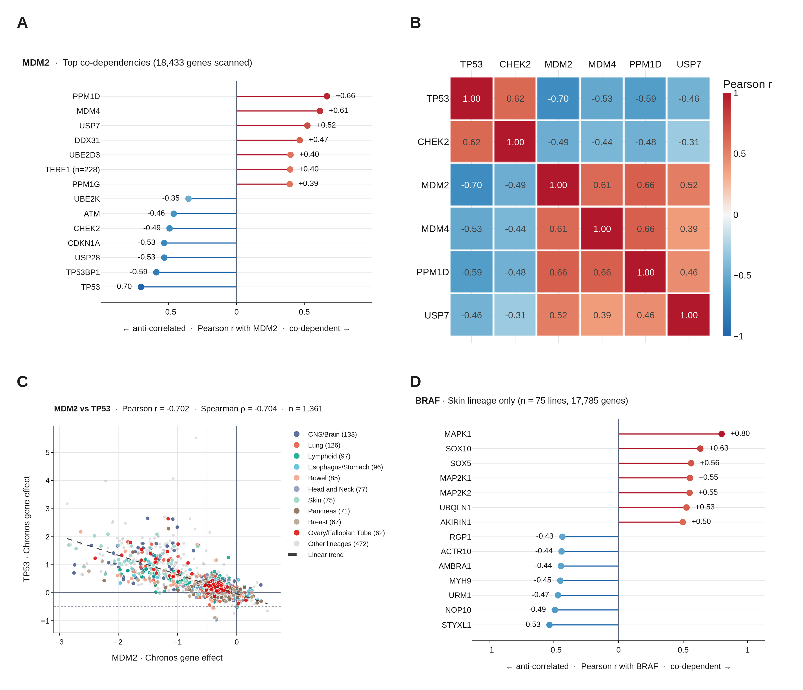

# CRISPR Score Analyzer: a cohort-scoped Python library, CLI, and interactive platform for DepMap gene essentiality and co-dependency analysis

**Changhao Kan¹,\***

¹ Institute of Molecular Physiology, Shenzhen Bay Laboratory, Shenzhen, China  
\* Correspondence: `kanchanghao@szbl.ac.cn`  
ORCID: [0009-0000-4014-5923](https://orcid.org/0009-0000-4014-5923)

**Category:** Bioinformatics (Application Note · Preprint)

---

## Abstract

**Summary:** Genome-scale CRISPR-Cas9 loss-of-function screens in the Cancer Dependency Map (DepMap) are widely used to prioritize candidate cancer targets, evaluate lineage-restricted vulnerabilities, and examine functional gene relationships. Tasks beyond single-gene portal lookups (placing multi-gene candidate panels on a cohort-wide essentiality curve, separating pan-cancer essentiality from lineage-specific dependency, pairing sensitive and resistant cell lines for wet-lab validation, running single-lineage genome-wide co-dependency scans, and exporting vector figures with analysis provenance) still typically require ad-hoc scripting. We present **CRISPR Score Analyzer**, an open-source Python package (`crispr-score-analyzer`) exposing a Streamlit-free analytical and plotting library, a reproducible command-line interface (`crispr-score-analyzer`), and an interactive browser platform bundling the DepMap Public 26Q3 Chronos gene effect matrix (1,361 cancer cell lines × 18,434 genes across 30 Oncotree lineages) and 40,402 unambiguous HGNC alias mappings, with support for validated custom CSV uploads. Across four workflows (*Gene ranking*, *Cancer-type comparison*, *Gene-set annotation*, and *Co-dependency*), users can analyze pan-cancer or lineage-restricted cohorts interactively or from scripts, run chunked vectorized Pearson or Spearman scans in seconds using NumPy and pandas without SciPy, render colorblind-safe Nature Publishing Group (NPG) and 7-stop ColorBrewer `RdBu` figures across light and deep-charcoal dark themes, and export white-paper PDF/SVG/300-DPI PNG figures alongside SHA-256 ZIP provenance bundles. Benchmark examples recover lineage-selective dependencies (`SOX10` in skin, `ESR1` in ER-positive breast models), the inverse correlation between `MDM2` and `TP53` Chronos gene-effect profiles across cancer cell lines (`r = −0.702`), and higher descriptive `BRAF`–MAPK correlations within skin cancer cell lines (`MAPK1` `r = +0.798`).

**Availability and Implementation:** Source code is freely available under the MIT license at https://github.com/ChanghaoKan/crispr-score-analyzer (archived software release `v1.2.0`: https://github.com/ChanghaoKan/crispr-score-analyzer/releases/tag/v1.2.0; commit `5c18f9b`; Zenodo version 1.2.0 DOI: `10.5281/zenodo.24458535`; concept DOI: `10.5281/zenodo.19607602`). A hosted web instance runs at https://crispr-score-analyzer-szbl-denglab.streamlit.app/. MIT Python wheels/sdists and release source archives exclude the bundled DepMap Public 26Q3 matrix, which is governed separately by Broad Institute DepMap Terms and Conditions (non-commercial research use only; reposted in full in `data/DEPMAP_TERMS.md`). The modular `crispr_score_analyzer` library, PEP 621 `pyproject.toml` packaging, CLI, updated browser UI/CNS plotting palettes, manuscript figures, and statistical reproduction scripts (`preprint/generate_figures.py` and `preprint/reproduce_stats.py`) are pinned at repository tag `preprint-v3` (with analytical computation kernels unchanged from `v1.2.0`). Exact reproduction from a clean Python 3.12 environment requires checking out `preprint-v3`, verifying `data/depmap_chronos.npz` against `data/depmap_chronos.provenance.json` (SHA-256 `ddf274da2aa5f89cf630bc8150dcd3a2c722466bd18ff6fb6d18fe161f8a0c67`, or rebuilding via `scripts/build_builtin_matrix.py`), installing via `pip install -e ".[app,dev]"` (or `requirements.txt`), and running both scripts.

**Keywords:** DepMap; CRISPR-Cas9 screen; Chronos gene effect; gene essentiality; co-dependency; Python library; reproducibility

---

## 1. Introduction

Pooled genome-scale CRISPR-Cas9 loss-of-function screens across human cancer cell lines, led by the Broad Institute Cancer Dependency Map (DepMap) (Tsherniak *et al.*, 2017; Meyers *et al.*, 2017; Dempster *et al.*, 2021), serve as a standard reference for oncology target prioritization, pathway mapping, and experimental model selection. Using copy-number- and kinetics-corrected Chronos gene effect scores (Dempster *et al.*, 2021), investigators routinely check whether candidate genes from transcriptomic, proteomic, or genetic screens act as pan-cancer essentials or context-restricted vulnerabilities.

Although the DepMap Portal (https://depmap.org/portal/) and companion resources such as shinyDepMap (Shimada *et al.*, 2021) and co-essentiality atlases (Wainberg *et al.*, 2021) handle routine single-gene lookups well, four practical gaps frequently appear during day-to-day panel prioritization:

1. **Multi-gene batch context:** Positioning a candidate panel of 5–50 genes together along a cohort-wide essentiality curve, or overlaying a prioritized subset onto a pathway background, usually requires repetitive single-gene lookups or ad-hoc R/Python scripting.
2. **Linking lineage summaries to wet-lab model selection:** Pan-cancer averages often dilute lineage- or subtype-restricted dependencies, whereas selecting concrete sensitive and resistant cell lines inside a chosen lineage scope requires cross-referencing multiple tables.
3. **Direct cohort-scoped genome-wide co-dependency scanning:** Default portal co-dependency tables report pan-cancer correlations in which inter-lineage variance can confound pathway co-essentiality; running a live single-lineage or subtype-restricted genome-wide scan typically requires multi-step Custom Analysis setup.
4. **Reproducible publication export:** Generating vector-editable figures (PDF/SVG) alongside exact numeric tables, data checksums, input-matching diagnostics, and environment metadata remains fragmented across web portals.

We developed **CRISPR Score Analyzer**, an open-source Python library, command-line tool, and interactive browser platform built around modular computation, explicit input-state isolation, transparent descriptive statistics, colorblind-safe vector figure export, and self-contained provenance archiving.

---

## 2. Implementation and Core Capabilities

### 2.1 Modular Architecture, Bundled Reference Data, Licensing, and Symbol Resolution

CRISPR Score Analyzer separates reusable scientific computation from interactive UI state inside a `pip`-installable PEP 621 Python package (`crispr_score_analyzer`, defined in `pyproject.toml`, requiring only pandas, NumPy, Plotly, Kaleido, and Pillow for headless library and CLI use, with Streamlit as an optional `[app]` extra for `app.py`). Four Streamlit-free modules—`analysis_core` (data loading, schema validation, HGNC alias resolution, ranking, lineage preference, and ZIP bundling), `codependency` (chunked `float64` genome-wide Pearson/Spearman scans and scatter builders), `plotting` (NPG/`RdBu` Plotly figure builders), and `figure_export` (deterministic white-paper vector/300-DPI export)—power both a scriptable CLI (`crispr-score-analyzer` with `info`, `rank`, `codep`, and `app` subcommands, documented in `docs/api.md`) and the bilingual (English/Chinese) Streamlit frontend, while thin root shims preserve backward compatibility.

For deterministic local and hosted startup without remote downloads, the repository checkout includes a compact `float32` binary matrix (`data/depmap_chronos.npz`, 88 MB; maximum absolute `float32` rounding deviation `1.19 × 10⁻⁷` across the first 100 genes) built from **DepMap Public 26Q3** (released October 5, 2026; https://forum.depmap.org/t/announcing-the-26q3-release/4692; Data Portal: https://depmap.org/portal/data_page/). Using `scripts/build_builtin_matrix.py`, official `CRISPRGeneEffect.csv` (497,139,964 bytes; MD5 `a0a87b48137996f620437604b8c2eb79`) and `Model.csv` (789,805 bytes; MD5 `a7423dbf345fcf5a822ab5fc7e854e5c`), retrieved on 2026-11-21, were validated for unique `ModelID` rows and `SYMBOL (Entrez ID)` headers. All **1,361 cancer cell lines** and **18,434 genes** in `CRISPRGeneEffect.csv` were retained verbatim without row filtering and left-joined on `ModelID` against deduplicated `Model.csv` to attach `OncotreeLineage` (1,361/1,361 matched across **30 Oncotree lineages**) and `CellLineName` (falling back to `ModelID` when blank), with SHA-256 and MD5 checksums recorded in `data/depmap_chronos.provenance.json`.

Software and data licensing are kept strictly separate. The MIT license covers only application source code (plus the CC0/public-domain HGNC alias map bundled in wheels), whereas rehosting `data/depmap_chronos.npz` in the GitHub repository and hosted Streamlit instance is governed by the Broad Institute DepMap Terms and Conditions (non-commercial research use only; commercial use requires a separate Broad license; full terms are reposted in `data/DEPMAP_TERMS.md` and inside the hosted web app per DepMap's *Continuity of Terms of Use* clause). Python wheels/sdists (`pyproject.toml`) and MIT GitHub/Zenodo source release archives (`.gitattributes`) strictly exclude `data/depmap_chronos.npz`. Optional subtype filtering (`OncotreePrimaryDisease` / `primary_disease`) activates automatically when present in custom uploaded CSVs.

Researchers can also pass or upload custom UTF-8 CRISPR score CSV matrices. To prevent numeric metadata columns from being parsed as genes, automatic gene detection strictly requires DepMap-style `SYMBOL (Entrez ID)` headers; plain-symbol tables require explicit manual score-column selection (via the sidebar or CLI `--gene-columns`). Ambiguous duplicate gene symbols and repeated metadata columns are excluded automatically and logged in a downloadable `diagnostics.csv` report.

Gene-list inputs accept arbitrary ASCII or full-width delimiters (newlines, spaces, tabs, commas, and semicolons), `.txt/.csv/.tsv` file uploads, and pasted DepMap headers (e.g., `MYC (4609)`). An offline HGNC symbol map (`data/gene_aliases.json`, **40,402** unambiguous previous-symbol and alias mappings; Seal *et al.*, 2023) resolves legacy names (such as `HER2 → ERBB2`) automatically. Input matching reports resolved aliases, deduplicated entries, and unmatched queries explicitly before and after execution while leaving exact matches unflagged.

### 2.2 Interface Design and Modular Analytical Workflows

The browser interface (**Figure 1**) separates translucent navigation chrome from solid, zero-color-cast analytical surfaces across a neutral light theme (`#f5f5f7`) and a deep-charcoal dark theme (`#0f0f11`, avoiding pure-black halation on desktop monitors). A sticky four-module segmented dock remains accessible while scrolling through figures and tables, and all four modules share a single sidebar cohort scope (**Cancer types** and optional **Disease / subtype** for custom datasets; **Table 1**):

1. **Gene ranking:** Ranks all valid genes within the active cohort by ascending mean finite Chronos gene effect (`rank`, `percentile = 100 × rank / N`, `n_valid`, and missingness counts). Interactive scatter curves render background genes via WebGL (`Scattergl`) for responsiveness and convert all traces to vector paths during PDF/SVG export. Two configurable reference anchors (default `MYC` and `PTEN`, with alias resolution) and a dashed `−0.5` screening reference line orient the curve alongside collision-avoided transparent labels with leader lines.
2. **Cancer-type comparison:** Generates horizontal per-lineage boxplots showing valid sample counts (`n`) per group, sorted by median score or alphabetically, with optional 2-column grids, single-axis multi-gene comparison, and cell-line point overlays annotated with display name and `ModelID`. Submissions exceeding eight matched genes prompt explicit subset selection while preserving the full submitted list in metadata.
3. **Gene-set annotation:** Plots a background gene set beneath a prioritized highlight layer on the cohort ranking curve with configurable colors, enabling pathway-level positioning without conflating visual inspection with formal enrichment testing.
4. **Co-dependency:** Provides two complementary modes with instant switching between **Pearson *r*** and **Spearman *ρ***:
   - *Genome-wide scan (1 gene):* Correlates a single query gene (entered via a native text field paired with a deterministic prefix/HGNC-alias search popover to avoid combobox and IME key-interception issues on numbered symbols such as `TEAD1`) against every other ranked gene in the active sidebar scope using exact pairwise-complete finite observations in `float64` precision across 2,048-gene column chunks. Pairs must satisfy `min_shared = min(10, max(3, n_valid_query))` (`n_shared ≥ 10` for cohorts of at least 10 lines) and non-zero variance; Spearman *ρ* resolves ties via average ranks using NumPy and pandas without SciPy. Outputs include a diverging top-partner lollipop chart, top-50 positive and negative tables showing `n_shared`, one-click transfer of top partners to a correlation matrix, and full-genome CSV export.
   - *Multi-gene matrix (2–25 genes):* Computes an interactive pairwise correlation heatmap paired with a **lineage-colored cell-line scatter plot**, ordinary least-squares trendline, and both Pearson *r* and Spearman *ρ* statistics for any selected gene pair.

**Figure 1. Interactive browser interface of CRISPR Score Analyzer across neutral light and deep-charcoal dark themes (identical default pan-cancer view).** **(A)** Light mode (`#f5f5f7` canvas) showing sidebar cohort controls (`DepMap Public 26Q3 · Chronos Gene Effect`), sticky four-module navigation dock (`Gene ranking`, `Cancer-type comparison`, `Gene-set annotation`, `Co-dependency`), gene-list draft input with `Examples`/`Search` popovers, status strip, and solid white-paper NPG ranking curve (labeled *Mean CRISPR score* in the generic UI to accommodate custom uploads using alternative scoring metrics). **(B)** Deep-charcoal dark mode (`#0f0f11` canvas) aligned on the same view, pairing stepped frosted surfaces (`#151518` sidebar, `#1c1c1e` cards) with darkroom NPG plot colors while keeping all figure exports white-paper by default.

**Table 1. Workflow comparison across CRISPR Score Analyzer and existing DepMap interfaces, verified November 2026 on equivalent gene-ranking, lineage-comparison, and co-dependency tasks.**

| Workflow dimension | DepMap Portal (26Q3; depmap.org/portal) | shinyDepMap (eLife 2021; shinyapps.io/depmap) | CRISPR Score Analyzer (v1.2.0 / `preprint-v3`) |
|---|---|---|---|
| Multi-gene placement on cohort ranking curve | Single-gene default (`Gene Page`) | Efficacy vs selectivity scatter (`Efficacy & Selectivity`) | Batch ranking + two-layer gene-set annotation |
| Cohort-scoped genome-wide co-dependency scan | Pan-cancer default; subsets via multi-step `Custom Analysis` | Pan-cancer clusters (`Connectivity`) | Single-step live scoped scan (Pearson *r* & Spearman *ρ*) |
| Pairwise multi-gene matrix & lineage scatter | `Data Explorer 2` / `Custom Analysis` small multiples | Cluster network view | 2–25 gene heatmap + integrated lineage scatter |
| Lineage preference vs all-lineage mean | Per-gene lineage & subtype distributions | Not provided | Diverging Top/Bottom-6 lollipop & multi-gene heatmap |
| Paired sensitive / resistant model lookup | Table filtering on `Gene Page` | Top sensitive cell lines | Paired most/least dependent tables + CSV export |
| Custom CRISPR score matrix upload & diagnostics | Single-feature custom vector (not full matrix) | Not supported | Full UTF-8 CSV matrix + strict schema + `diagnostics.csv` |
| Offline batch HGNC alias resolution | Online single-gene search | Not provided | 40,402 unambiguous offline mappings (batch & single) |
| Programmatic Python API & scriptable CLI | Web portal / manual file download | R Shiny web app only | `pip`-installable Streamlit-free Python library + CLI |
| Colorblind-safe figures, themes & provenance export | Separate chart and CSV downloads | Separate PNG and CSV | NPG/`RdBu` palettes, light/dark UI, white-paper PDF/SVG/PNG + SHA-256 ZIP |

### 2.3 Deep-Dive Views, Publication Palettes, State Integrity, and Performance

Beneath ranking, comparison, and annotation results, two contextual deep-dive tabs support immediate follow-up without leaving the active module: (i) **Lineage preference**, comparing every cancer lineage (`n_valid ≥ 5`) against each gene's full-dataset mean (independent of the sidebar filter, outlining active lineages) in Top/Bottom-6 lollipop or diverging heatmap views alongside median difference and the fraction of lines scoring `< −0.5`; and (ii) **Top cell lines**, listing the most dependent and least dependent models in the active scope for experimental selection.

All interactive plots and exports use colorblind-safe publication palettes: Nature Publishing Group (`NPG`) categorical hues (`#3C5488` deep indigo for query genes, `#E64B35` vermilion for `MYC`, `#00A087` teal for `PTEN`, and a 12-lineage NPG scatter palette, eliminating red–green conflicts) paired with a 7-stop ColorBrewer `RdBu` diverging scale (`#B2182B` deep crimson for positive correlation or less-dependent shifts; `#2166AC` deep steel blue for negative correlation or more-dependent shifts). All figure exports enforce white paper backgrounds, marker halos, transparent label boxes, and automatic dark-to-light `RdBu` conversion when exporting from dark mode, caching rendered bytes by exact figure fingerprint and dimensions (PNG output capped at 24 million pixels).

To prevent mismatch between displayed outputs and edited inputs, gene-list edits remain uncommitted drafts until explicitly run, and changes to the dataset, column mapping, or sidebar scope invalidate prior results and exports. An on-demand **Complete analysis ZIP** bundles `selected_results.csv`, `full_rankings.csv`, `plot_data.csv`, `lineage_preference.csv`, `diagnostics.csv`, and `metadata.json` (recording data SHA-256, release version, Zenodo DOI, cohort parameters, input matching, and Python package versions).

On a 2-vCPU Linux container (`Python 3.12.16`, `NumPy 2.5.5`, `pandas 2.3.3`, `Streamlit 1.67.0`, `Plotly 6.9.0`, `Kaleido 0.2.1`), median wall-clock times across three runs on the bundled 88 MB DepMap Public 26Q3 matrix are **1.01 s** for matrix loading (`0.97–1.33 s`), **0.41 s** for ranking all 18,434 genes (`0.38–0.73 s`), and **0.82 s** (Pearson *r*, `0.66–0.85 s`) or **6.21 s** (Spearman *ρ*, `6.12–6.77 s`) for a pan-cancer genome-wide co-dependency scan across 18,433 partner genes. Analytical, library, CLI, UI, and export behavior is verified offline on deterministic synthetic fixtures by **98 automated tests** across Python 3.11 and 3.12 via GitHub Actions continuous integration.

---

## 3. Benchmark Use Cases

### 3.1 Separating Pan-Cancer Essentiality from Lineage-Selective Vulnerability

On initial launch with DepMap Public 26Q3 (`n = 1,361` cell lines; `1,712` genes with pan-cancer mean `< −0.5`, range `−5.250` to `+0.398`), CRISPR Score Analyzer displays a default five-gene panel (`KRAS`, `SOX10`, `BRAF`, `ESR1`, `TP53`) anchored by `MYC` (mean `−1.971`, rank `187`, `1.01%`) and `PTEN` (mean `+0.377`, rank `18,428`, `99.97%`) (**Figure 2A**). Across all lineages, `KRAS` falls below the `−0.5` screening reference (mean `−0.729`, rank `1,263`, `6.85%`), whereas tumor suppressor `TP53` sits at the positive extreme (mean `+0.381`, rank `18,430`, `99.98%`), consistent with prior DepMap reports of knockout-induced proliferation advantage in *TP53*-wild-type models (Tsherniak *et al.*, 2017; Dempster *et al.*, 2021), although somatic mutation calls are not bundled in the default matrix. By contrast, two established lineage-restricted dependencies appear modest or near-neutral in pan-cancer means: `SOX10` (mean `−0.347`, rank `2,225`, `12.07%`) and `ESR1` (mean `−0.065`, rank `7,347`, `39.86%`).

The **Lineage preference** tab separates mean shifts from sample-size effects and distributional skew (**Figure 2C, D**, noting gene-specific x-axis scales). Relative to its all-lineage mean (`−0.347`), `SOX10` shows a consistent skin-lineage shift (`mean = −1.487`, `Δ = −1.140`, `median Δ = −1.368`, `78.7% < −0.5`, `n = 75`). In ocular models (`Eye`, `n = 15`), the mean shift (`Δ = −0.535`, `mean = −0.882`) exceeds the median shift (`median Δ = −0.174`), reflecting strong dependency restricted to a uveal melanoma subset (e.g., `Omm2.5` `−2.752`, `UPMM3` `−2.113`) alongside near-neutral retinoblastoma and retinal pigment epithelial lines. For `ESR1`, `Breast` (`n = 67`) yields a modest lineage-mean shift (`mean = −0.285`, `Δ = −0.220`, `median Δ = −0.061`, `17.9% < −0.5`), followed closely in Figure 2D by a small `Ampulla of Vater` group (`n = 9`, `Δ = −0.174`, `median Δ = −0.059`). Because the bundled matrix stores only `OncotreeLineage` without breast receptor or PAM50 subtype annotations, lineage-level means compress ER-positive luminal dependency into a modest average. Checking the **Top cell lines** tab resolves this masking by surfacing established ER-positive models (`HCC1428` [`ACH-000352`, `−1.912`], `T-47D` [`ACH-000147`, `−1.845`], `MDA-MB-415` [`ACH-000876`, `−1.636`]) alongside resistant negative controls, while custom CSV uploads containing `OncotreePrimaryDisease` enable subtype-level filtering. In the **Gene-set annotation** module, mitotic kinases `PLK1` (mean `−2.691`, rank `38`, `0.21%`) and `AURKA` (mean `−1.236`, rank `626`, `3.40%`) can be overlaid onto a seven-gene cell-cycle CDK/cyclin background (`CDK1` `−2.588` through `CCNE1` `−0.194`; **Figure 2B**).

**Figure 2. Multi-gene Chronos gene effect positioning and lineage preference across DepMap Public 26Q3 (`n = 1,361` cell lines, `18,434` genes; Nature NPG and ColorBrewer `RdBu` palettes).** **(A)** Pan-cancer mean Chronos gene effect ranking of five benchmark cancer genes (`KRAS`, `SOX10`, `BRAF`, `ESR1`, `TP53`) relative to `MYC` and `PTEN` reference anchors and the `−0.5` screening reference line. **(B)** Two-layer gene-set annotation highlighting `PLK1` and `AURKA` over seven cell-cycle CDK/cyclin background genes (`CDK1`, `CDK2`, `CDK4`, `CDK6`, `CCNB1`, `CCND1`, `CCNE1`; listed in panel legend). **(C, D)** Diverging lineage preference lollipops (top and bottom 4 lineages with `n ≥ 5`, sample sizes shown on y-axis; note gene-specific x-axis scales) showing mean Chronos difference relative to each gene's all-lineage mean for `SOX10` (**C**, Skin and Eye shifts) and `ESR1` (**D**, Breast alongside small-sample Ampulla of Vater `n = 9`).

### 3.2 Benchmarking Pan-Cancer and Single-Lineage Co-Dependency Exploration

To evaluate co-dependency workflows in the **Co-dependency** module, we first ran a pan-cancer genome-wide Pearson scan of `MDM2` across all `18,433` other ranked genes (`0.82 s`; **Figure 3A**). The diverging lollipop recovers the `TP53`–`MDM2` regulatory axis: top positive co-dependencies include `PPM1D` (`r = +0.664`), `MDM4` (`r = +0.614`), `USP7` (`r = +0.522`), `DDX31` (`r = +0.466`), and `UBE2D3` (`r = +0.398`, all `n_shared = 1,361`), whereas top anti-correlated partners include `TP53` (`r = −0.702`), `TP53BP1` (`r = −0.589`), `USP28` (`r = −0.531`), `CDKN1A` (`r = −0.530`), `CHEK2` (`r = −0.491`), and `ATM` (`r = −0.461`, all `n_shared = 1,361`). Displaying `n_shared` directly in scan outputs flags `TERF1` (`r = +0.395`, rank 6 positive) as partially covered (`n_shared = 228` vs `1,361`), preventing sparse-coverage correlations from being weighted equally with full-panel hits. Transferring the six-gene regulatory panel (`TP53`, `CHEK2`, `MDM2`, `MDM4`, `PPM1D`, `USP7`) to multi-gene matrix mode resolves the two-block inverse correlation structure (**Figure 3B**), and the integrated cell-line scatter plot of `MDM2` vs `TP53` (`r = −0.702`, `ρ = −0.704`, `n = 1,361`; **Figure 3C**) shows cell lines across multiple lineages following a similar negative trend. Offline verification (`preprint/reproduce_stats.py`) confirms that demeaning both genes by `OncotreeLineage` retains a strong within-lineage pooled correlation (`r = −0.648`, `n = 1,361` across 30 lineages), and all 23 lineages with `n ≥ 15` show negative correlations (median `r = −0.680`; e.g., Lung `r = −0.802` [`n = 126`], Skin `r = −0.793` [`n = 75`], Breast `r = −0.719` [`n = 67`], Bowel `r = −0.674` [`n = 85`], CNS/Brain `r = −0.663` [`n = 133`], Lymphoid `r = −0.609` [`n = 97`]).

Pan-cancer correlations of tissue-enriched oncogenes, by contrast, mix pathway co-essentiality with inter-lineage variance. In a pan-cancer scan of `BRAF`, core MAPK components show moderate-to-strong descriptive correlations (`MAPK1` `r = +0.644`, `MAP2K1` `r = +0.391`, `MAP2K2` `r = +0.271`) alongside melanoma lineage factors (`SOX10` `r = +0.544`, `DUSP4` `r = +0.474`; `SOX5` `r = +0.208`). Filtering the sidebar scope to **Skin** (`n = 75` cell lines; `17,785` partner genes meeting `n_shared ≥ 10`, with `648` sparser genes excluded) and re-running the scan produces top seven positive correlations for `MAPK1` (`r = +0.798`), `SOX10` (`+0.633`), `SOX5` (`+0.562`), `MAP2K1` (`+0.552`), `MAP2K2` (`+0.550`), `UBQLN1` (`+0.526`), and `AKIRIN1` (`+0.496`), with a negative tail led by `STYXL1` (`−0.534`; all `n_shared = 75`; **Figure 3D**). Restricting to Skin therefore increases descriptive RAF–MEK–ERK correlations relative to the pan-cancer scan. An offline OLS partial-correlation check regressing both `BRAF` and each partner's Chronos gene effect on `SOX10` across all `n = 75` complete Skin models (zero missing values; `preprint/reproduce_stats.py`) retains `MAPK1` (`partial r = +0.665`), `MAP2K1` (`+0.467`), and `MAP2K2` (`+0.398`), yet the top list is not a pure MAPK module. The persistence of `SOX10` and `SOX5` reflects Oncotree `Skin` heterogeneity spanning *SOX10*-high cutaneous melanoma and *SOX10*-low non-melanoma or dedifferentiated skin models (e.g., `HSC-5`, `MCC26`, `RVH421_DAB_R`). Post-hoc two-sided Pearson *t*-tests across all `17,785` Skin partner genes (`n_shared = 75` each; `preprint/reproduce_stats.py`, computed outside the descriptive browser UI) further show how candidates near `|r| ≈ 0.50` differ sharply from `MAPK1` (`p = 9.72 × 10⁻¹⁸`, Bonferroni `1.73 × 10⁻¹³`): `AKIRIN1` (`p = 5.95 × 10⁻⁶`, Bonferroni `0.106`), `UBQLN1` (`p = 1.29 × 10⁻⁶`, Bonferroni `0.023`), and `STYXL1` (`p = 8.28 × 10⁻⁷`, Bonferroni `0.015`) remain exploratory leads requiring independent validation.

**Figure 3. Pan-cancer and single-lineage genome-wide co-dependency benchmarks (ColorBrewer `RdBu` correlation convention: positive crimson `#B2182B`, negative steel blue `#2166AC`; 12-lineage NPG scatter palette).** **(A)** Pan-cancer genome-wide Pearson *r* scan of `MDM2` across `18,433` genes (`n = 1,361` cell lines), displaying the top 7 positive (`PPM1D`, `MDM4`, `USP7`, `DDX31`, `UBE2D3`, `TERF1 [n = 228]`, `PPM1G`) and top 7 negative (`TP53`, `TP53BP1`, `USP28`, `CDKN1A`, `CHEK2`, `ATM`, `UBE2K`) partners. **(B)** Pairwise Pearson correlation matrix for the six-gene `TP53`–`MDM2` regulatory axis. **(C)** Lineage-colored cell-line scatter plot of `MDM2` vs `TP53` Chronos gene effect (`r = −0.702`, Spearman `ρ = −0.704`, `n = 1,361`) with linear trendline. **(D)** Cohort-scoped genome-wide `BRAF` scan restricted to `Skin` cell lines (`n = 75`, `17,785` genes with `n_shared ≥ 10`), showing higher descriptive MAPK cascade correlations (`MAPK1` `+0.80`, `MAP2K1` `+0.55`, `MAP2K2` `+0.55`) co-ranking with lineage factors (`SOX10` `+0.63`, `SOX5` `+0.56`) and exploratory hits near `|r| ≈ 0.50` (all `n_shared = 75`).

---

## 4. Scope, Limitations, and Scientific Interpretation

CRISPR Score Analyzer is built for exploratory visualization rather than formal statistical hypothesis testing. Four interpretive limits apply to all outputs:

- **Descriptive metrics only:** Cohort gene ranks, lineage preference mean/median differences, and co-dependency correlation coefficients are descriptive summaries. They do not represent formal tests of selectivity, differential dependency, multiple-testing-corrected significance, or synthetic lethality, and should be followed by statistical modeling or experimental validation.
- **Reference threshold:** The `−0.5` dashed line serves solely as a visual screening reference on Chronos gene effect scores, not as a formal classifier of common-essential genes.
- **Confounding and multiplicity in co-dependency scans:** High correlation between two genes can reflect physical complex membership, shared signaling pathways, residual subtype or cell-state heterogeneity, common-essentiality variance, or small-sample multiplicity when scanning ~18,000 genes within one lineage. Checking shared sample counts (`n_shared`), Spearman *ρ* alongside Pearson *r*, and lineage-colored cell-line scatter plots is necessary before inferring direct genetic interaction.
- **Bundled metadata and custom upload assumptions:** The bundled DepMap Public 26Q3 matrix includes `OncotreeLineage` without mutation, expression, or PAM50/receptor subtype columns; users requiring subtype stratification should upload custom CSVs containing `OncotreePrimaryDisease` or equivalent metadata. Uploaded score matrices are assumed to contain one row per unique cell line; duplicate rows are not silently deduplicated.

---

## Acknowledgements and Disclosures

**Acknowledgements:** The author thanks Dr. Lin Deng and Dr. Zixi Wang (Institute of Molecular Physiology, Shenzhen Bay Laboratory) for their constructive suggestions and feedback.

**Ethics Statement:** This work analyzes publicly available, de-identified cancer cell-line dependency scores from DepMap Public 26Q3 and synthetic software test fixtures; no new human subjects, clinical patient records, or animal experiments were involved, and institutional ethics approval is not applicable.

**Data Source and Terms:** Reference dependency data derive from DepMap Public 26Q3 Chronos Gene Effect scores (released October 5, 2026; https://forum.depmap.org/t/announcing-the-26q3-release/4692; Data Portal: https://depmap.org/portal/data_page/). The bundled matrix is governed by Broad Institute DepMap Terms and Conditions (non-commercial research use only; reposted in full in `data/DEPMAP_TERMS.md` and inside the hosted web app), separate from the MIT-licensed application code.

**AI Assistance Disclosure:** Large language model coding assistants (Claude, Codex, and Gemini/Antigravity coding agents) were used to assist with modular software engineering, automated testing, and manuscript editing. All scientific specifications, biological case studies, verification, and final manuscript decisions were reviewed and approved by the author.

**Funding:** This work received no specific external funding.

**Competing Interests:** The author declares no competing financial or non-financial interests.

**Data and Code Availability:** The MIT-licensed software release (`v1.2.0`, commit `5c18f9b`) is hosted at https://github.com/ChanghaoKan/crispr-score-analyzer/releases/tag/v1.2.0 and archived on Zenodo (version 1.2.0 DOI: `10.5281/zenodo.24458535`; concept DOI: `10.5281/zenodo.19607602`); the hosted web tool is accessible at https://crispr-score-analyzer-szbl-denglab.streamlit.app/. Because Python distribution wheels/sdists and MIT release archives exclude `data/depmap_chronos.npz` under DepMap terms, the modular `crispr_score_analyzer` library, CLI, updated UI/CNS plotting palettes, and manuscript figure and statistical reproduction scripts (`preprint/generate_figures.py` and `preprint/reproduce_stats.py`) are pinned at repository tag `preprint-v3` (analytical computation kernels are unchanged from `v1.2.0`). From a clean Python 3.12 environment, all quantitative figures (`Figure 2` and `Figure 3`, plus re-compositing `Figure 1` from bundled UI captures `ui_light.png` and `ui_dark.png`) and statistics can be reproduced via `git clone https://github.com/ChanghaoKan/crispr-score-analyzer.git && cd crispr-score-analyzer && git checkout preprint-v3 && python -m venv .venv && .venv/bin/pip install -e ".[app,dev]" && .venv/bin/python preprint/generate_figures.py && .venv/bin/python preprint/reproduce_stats.py`, verifying `data/depmap_chronos.npz` against `data/depmap_chronos.provenance.json` (`matrix_sha256`: `ddf274da2aa5f89cf630bc8150dcd3a2c722466bd18ff6fb6d18fe161f8a0c67`, or rebuilding from official 26Q3 files via `scripts/build_builtin_matrix.py`).

---

## References

- Dempster, J. M., Boyle, I., Vazquez, F., Root, D. E., Boehm, J. S., Hahn, W. C., Tsherniak, A., & McFarland, J. M. (2021). Chronos: a cell population dynamics model of CRISPR experiments that improves inference of gene fitness effects. *Genome Biology*, 22(1), 343. https://doi.org/10.1186/s13059-021-02540-7
- DepMap, Broad. (2026). DepMap Public 26Q3 Chronos Gene Effect dataset (released October 5, 2026). Broad Institute. https://depmap.org/portal/data_page/ (Release notes: https://forum.depmap.org/t/announcing-the-26q3-release/4692)
- Kan, C. (2026). CRISPR Score Analyzer (1.2.0) [Software]. Zenodo. https://doi.org/10.5281/zenodo.24458535 (Concept DOI: https://doi.org/10.5281/zenodo.19607602)
- Meyers, R. M., Bryan, J. G., McFarland, J. M., Weir, B. A., Sizemore, A. E., Xu, H., *et al.* (2017). Computational correction of copy number effect improves specificity of CRISPR-Cas9 essentiality screens in cancer cells. *Nature Genetics*, 49(12), 1779–1784. https://doi.org/10.1038/ng.3984
- Seal, R. L., Braschi, B., Gray, K., Jones, T. E. M., Tweedie, S., Haim-Vilmovsky, L., & Bruford, E. A. (2023). Genenames.org: the HGNC resources in 2023. *Nucleic Acids Research*, 51(D1), D1003–D1009. https://doi.org/10.1093/nar/gkac888
- Shimada, K., Bachman, J. A., Muhlich, J. L., & Mitchison, T. J. (2021). shinyDepMap, a tool to identify targetable cancer genes and their functional connections from Cancer Dependency Map data. *eLife*, 10, e57116. https://doi.org/10.7554/eLife.57116
- Tsherniak, A., Vazquez, F., Montgomery, P. G., Weir, B. A., Kryukov, G., Cowley, G. S., *et al.* (2017). Defining a Cancer Dependency Map. *Cell*, 170(3), 564–576.e16. https://doi.org/10.1016/j.cell.2017.06.010
- Wainberg, M., Kamber, R. A., Balsubramani, A., Meyers, R. M., Sinnott-Armstrong, N., Hornburg, D., *et al.* (2021). A genome-wide atlas of co-essential modules assigns function to uncharacterized genes. *Nature Genetics*, 53(5), 638–649. https://doi.org/10.1038/s41588-021-00840-z
